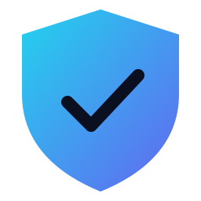
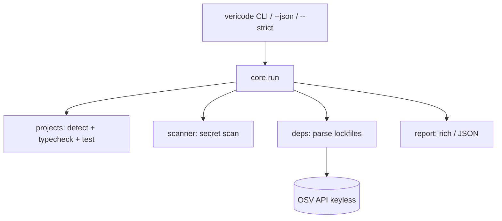

<div align="center">



# VeriCode

**Verify AI-generated code actually works — locally, no config.**

Type-check · run tests · scan for hardcoded secrets · check dependencies for known CVEs.
One command. Zero setup. Your code never leaves your machine (CVE lookup is keyless & anonymous).

[](https://github.com/LucasXlab/vericode/actions)
[](LICENSE)
[](https://pypi.org/project/vericode/)
[](https://pypi.org/project/vericode/)

</div>

---

## Demo

```bash
$ pip install vericode
$ cd my-ai-project
$ vericode .

  VeriCode · /home/you/my-ai-project
┏━━━━━━━━━━━┳━━━━━━┳━━━━━━━━━━━━━━━━━━━━━━━━━━━━━━━━━━━━┓
┃ Check     ┃ Status ┃ Detail                               ┃
┡━━━━━━━━━━━╇━━━━━━┇━━━━━━━━━━━━━━━━━━━━━━━━━━━━━━━━━━━━┩
│ typecheck │ –      │ mypy/pyright not installed          │
│ tests     │ ✓      │ pytest: passed                      │
└───────────┴────────┴────────────────────────────────────┘
✓ No hardcoded secrets detected
✓ No known vulnerabilities in dependencies

Result: All checks passed (1 skipped)
```

> The demo GIF is generated from [`demo.tape`](demo.tape) with [`vhs`](https://github.com/charmbracelet/vhs):
> `vhs demo.tape` → `assets/demo.gif`.

## Why

AI coding agents write code that *looks* right but often isn't. VeriCode is the
"trust but verify" layer you run before you commit, open a PR, or ship.

| | VeriCode | gitleaks | Snyk | Dependabot | `grep` |
|---|---|---|---|---|---|
| Secret scanning | ✅ built-in | ✅ | ✅ | ❌ | ⚠️ |
| Type-check / test run | ✅ | ❌ | ❌ | ❌ | ❌ |
| Dependency CVE (keyless) | ✅ | ❌ | ✅ (account) | ✅ (PR only) | ❌ |
| Local-first / no account | ✅ | ✅ | ❌ | ❌ | ✅ |
| One command for all of it | ✅ | ❌ | ❌ | ❌ | ❌ |

## Quick Start

```bash
pip install vericode
vericode .                 # scan the current project
vericode . --strict       # CI gate: non-zero exit on any problem
```

## Features

- **Project detection** for Python, Node, Go and Rust (extensible).
- **Type-check**: `mypy`/`pyright`, `tsc --noEmit`, `go vet`, `cargo check`
  (honestly skips when the tool isn't installed).
- **Tests**: `pytest`, `npm test`, `go test`, `cargo test`.
- **Secret scanning**: dependency-free regex + Shannon-entropy heuristics for
  AWS / private keys / Slack / Stripe / GitHub / GitLab tokens, JWTs and
  generic `api_key = "..."` assignments.
- **CVE check**: parses `requirements.txt`, `Pipfile.lock`, `package-lock.json`,
  `go.mod`, `Cargo.lock` and queries the free, keyless [OSV API](https://osv.dev).
- **`--json`** for machine consumption, **`--strict`** for CI, **`--no-cve`**
  to skip the network, **`--exclude`** to ignore paths.

## Architecture



## Roadmap

- [ ] SARIF output for GitHub code scanning
- [ ] HTML report
- [ ] Historical trend comparison
- [ ] Configurable rule allow/deny lists

## Contributing

See [CONTRIBUTING.md](CONTRIBUTING.md). Small, atomic PRs welcome.

## License

[MIT](LICENSE) © 2026 Noah Forge
