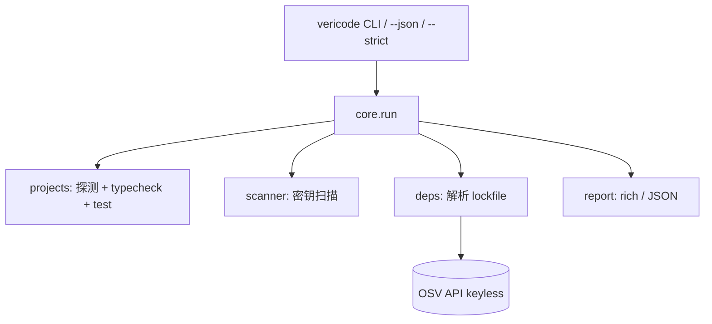

# SPEC · VeriCode

> 阶段 4 产出（Architect）。立项选项：**VeriCode**（阶段 3 Top 2，中位 9.0，MVP 最易、演示最清晰）。
> 赛道：**「AI 代码完整性」**——接住 AI 写的代码，让它"真能用、不泄密、无已知漏洞"。

---

## 1. 目标用户
- **一级**：用 Claude Code / Codex / Cursor / Aider 等生成代码的开发者，拿到一段 AI 代码后想"先验证再信任"。
- **二级**：做代码评审的工程师、安全敏感的独立开发者、CI 中想加一道"AI 代码门禁"的团队。

## 2. 核心场景（10 秒演示支撑）
开发者克隆/生成了一个 AI 项目，`cd` 进去后执行：
```
vericode .
```
终端立刻给出一张清单：
- 类型检查：✓ 无错误 / ✗ 3 处类型错误
- 测试：✓ 12 passed / ✗ 2 failed
- 密钥：✗ 发现硬编码 AWS Key（file:line）
- 依赖：✗ requests==2.19.0 存在 2 个 CVE
一句话结论 + `--strict` 可在 CI 里直接失败退出。

## 3. 功能清单
### P0（撑起 10 秒演示，其余全砍）
- 目录扫描 + 项目类型探测（Python / Node / Go / Rust）
- 类型检查：调用 `mypy`/`tsc --noEmit`/`go vet`/`cargo check`（工具缺失则诚实 skip）
- 测试执行：调用 `pytest`/`npm test`/`go test`/`cargo test`
- 密钥扫描：内置正则 + 熵检测，识别 AWS/私钥/Token/JWT/通用赋值
- 依赖 CVE：解析 lockfile → 批量查询 OSV（keyless、免费）
- 报告：rich 终端表格 + `--json`；`--strict` 非零退出
- 退出码语义明确（0 通过 / 1 有问题 / 2 错误）

### P1（一周内若有余力）
- 可配置规则白名单/忽略
- 多目录批量扫描
- 与 gitleaks 等外部工具可选集成

### P2（后续，不在首版）
- SARIF 输出接入 GitHub code scanning
- Web UI / HTML 报告
- 历史趋势对比

## 4. 架构图（Mermaid）


## 5. 目录结构
```
vericode/
├── pyproject.toml
├── vericode/
│   ├── __init__.py
│   ├── cli.py          # 入口 (click)
│   ├── core.py         # 编排
│   ├── scanner.py      # 密钥扫描
│   ├── projects.py     # 项目探测/类型检查/测试
│   ├── deps.py         # 依赖解析 + OSV 查询
│   └── report.py       # 终端/JSON 报告
├── tests/              # pytest 单测
├── .github/workflows/ci.yml
├── LICENSE  CONTRIBUTING.md  README.md  README.zh-CN.md
├── .env.example  .gitignore
└── assets/  (logo.svg, social-preview.svg)
```

## 6. 技术选型理由
- **语言 Python**：跨平台、打包简单（`pipx`/`pip install`）、测试生态成熟，且本身是"被验证对象"之一。
- **click**：CLI 标准库级体验，参数清晰。
- **rich**：表格化报告让演示"好看"，提升传播性。
- **requests + OSV API**：OSV 免费、无需密钥、覆盖 PyPI/npm/Go/crates，真实可用而非 mock。
- **密钥扫描自研正则+熵**：避免引入重型依赖；规则透明、可审计。

## 7. 测试策略
- 单元测试（pytest）覆盖核心逻辑：扫描正则命中/误报、各 lockfile 解析、项目探测、编排。
- 目标：**核心逻辑覆盖率 ≥ 70%**。
- CI：GitHub Actions（`ruff` lint + `pytest --cov`）。
- 真实运行：用 `vericode .` 对自身仓库做自验证（dogfood）。

## 8. 里程碑（Day 1–7）
- **D1** 脚手架 + pyproject + CLI 骨架 + 项目探测。
- **D2** scanner（正则+熵）+ 单测。
- **D3** projects 类型检查/测试调用 + 单测。
- **D4** deps 解析 + OSV 查询 + 单测（mock 网络）。
- **D5** report 渲染 + `--json/--strict` + core 编排 + 自验证 `vericode .`。
- **D6** 打磨：错误提示、默认值、CI、LICENSE/CONTRIBUTING/README。
- **D7** QA 新环境跑通 + 录制演示 + 评审（/simplify /code-review /security-review）修复。
